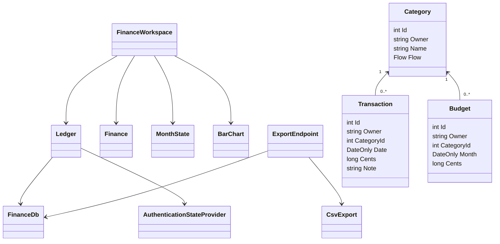
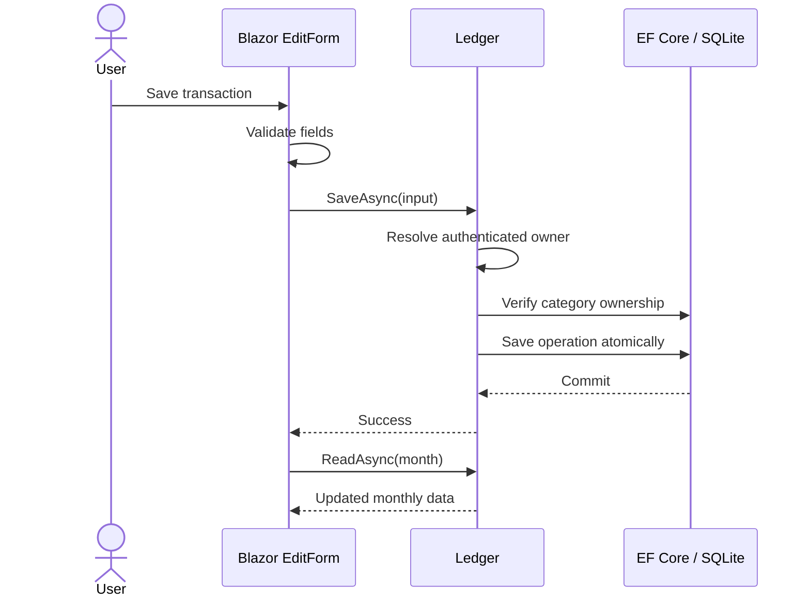

# Architecture

Finance Tracker uses ASP.NET Core Blazor Interactive Server. Components handle presentation and input state. Ledger coordinates authorization, validation and persistence. Finance and CsvExport calculate values from explicit inputs. FinanceDb stores financial entities and ApplicationDbContext stores Identity entities.

## Responsibilities

| Area | Responsibility |
|---|---|
| Components/Pages | Dashboard, transaction editor, categories, budgets, analytics |
| Reusable components | Metrics, bar charts, month selector and action controls |
| Domain/Finance.cs | Immutable entries/totals, pure sums, forecast and exact minor-unit conversion |
| Data/Ledger.cs | Current-user ownership, business validation and async CRUD |
| Data/FinanceDb.cs | Tables, indexes, owner-aware relations and delete restrictions |
| Data/ExportEndpoint.cs | Authenticated, monthly CSV download |
| Components/Account | ASP.NET Core Identity account UI |
| FinanceTracker.Tests | Calculation and actual SQLite integration tests |

## UML class diagram

## Sequence diagram

## Persistence and consistency

Money uses long integers representing hundredths of one tenge. Input uses decimal and conversion rounds halfway away from zero. Each service action opens and disposes its own context. Reads use AsNoTracking. Indexes cover owner/date and unique owner/month/category budgets. Composite foreign keys include Owner so another account's category cannot be referenced even through direct database insertion.

A single SaveChanges call is atomic. Sample generation runs inside a transaction. Unique constraints arbitrate concurrent duplicate inserts. Concurrent edits to the same row currently use last-write-wins semantics. AccountDeletion attaches the finance file to the Identity connection and deletes both stores in one transaction. Both files use DELETE rollback journals. Ledger saves start their write transactions before validation queries to avoid read-to-write lock upgrade conflicts.

The Identity schema uses migrations. FinanceDb uses EnsureCreated for the initial schema. Model evolution for existing data requires a migration strategy.

## Functional programming and supplied reading

Vaskaran Sarcar, Introducing Functional Programming Using C# (2023), covers pure functions, immutable values, lambdas and composition. Entry and Totals are immutable records. Summarize uses Aggregate and with to return a new total for each input.

Simon J. Painter, Functional Programming with C# (2023), motivates expressing transformations as functions. Spending composes Where, GroupBy and Sum. UI predicates are passed to LINQ rather than duplicating selection logic.

The supplied Functional Programming with C# — Unlock Coding Brilliance with the Power of Functional Magic includes chapters on pure functions, side effects, and pipelines/composition. Forecast receives spent amount, elapsed days and month length explicitly. It does not read the clock or database. Side effects are concentrated in Ledger and Demo.

The record LedgerMonth contains arrays of EF entities and therefore has shallow immutability. The value records used by the calculation layer contain immutable scalar values. Form models remain mutable because Blazor binds inputs to their properties.

## Export contract

GET /exports/transactions?month=2026-11 requires authentication. An invalid or out-of-range month returns HTTP 400. The query filters by the authenticated owner and month. It returns a UTF-8 CSV attachment with date, category, flow type, amount in KZT and note. It includes the whole selected month. Text cells are quoted, quotes are escaped and potential spreadsheet formulas receive an apostrophe prefix. Cache-Control is no-store.

## Technology decisions

Blazor Interactive Server provides C# event handlers and server-side access with a persistent browser connection. WebAssembly would run the UI on the client and require a backend for shared persistence. MVC provides request-response forms and would need additional UI requests for this interaction pattern.

SQLite provides file-based storage for a local project. A database server such as PostgreSQL is a possible future option when concurrent writes or multiple application instances are required.

## Account deletion verification

The account settings deletion form requires the current password and an antiforgery token. It removes all transactions, budgets and categories across all months, plus the Identity account and cascading authentication records. On success the browser signs out and returns to the landing page.

Five new integration tests verify all-month removal and preservation of another owner, invalid-password preservation, an injected failure during Identity deletion with full finance rollback and successful retry, empty-account deletion, and stale-version rejection. They also verify claims/logins/tokens are removed, the old login is rejected, the same email can register a new empty account, and a stale tab cannot recreate categories for the deleted owner.

Deletion uses one SQLite ATTACH transaction with DELETE journals in both files; runtime failures roll back the operation. This follows the [SQLite attached-database transaction requirements](https://www.sqlite.org/lang_attach.html). The service rejects an incompatible journal configuration. A minimal DeletedAccounts marker retains only the opaque account ID to prevent stale circuits recreating records; it contains no email, credentials or financial data. Deletion removes live records, not previously exported CSV files, backups or forensic disk remnants.
