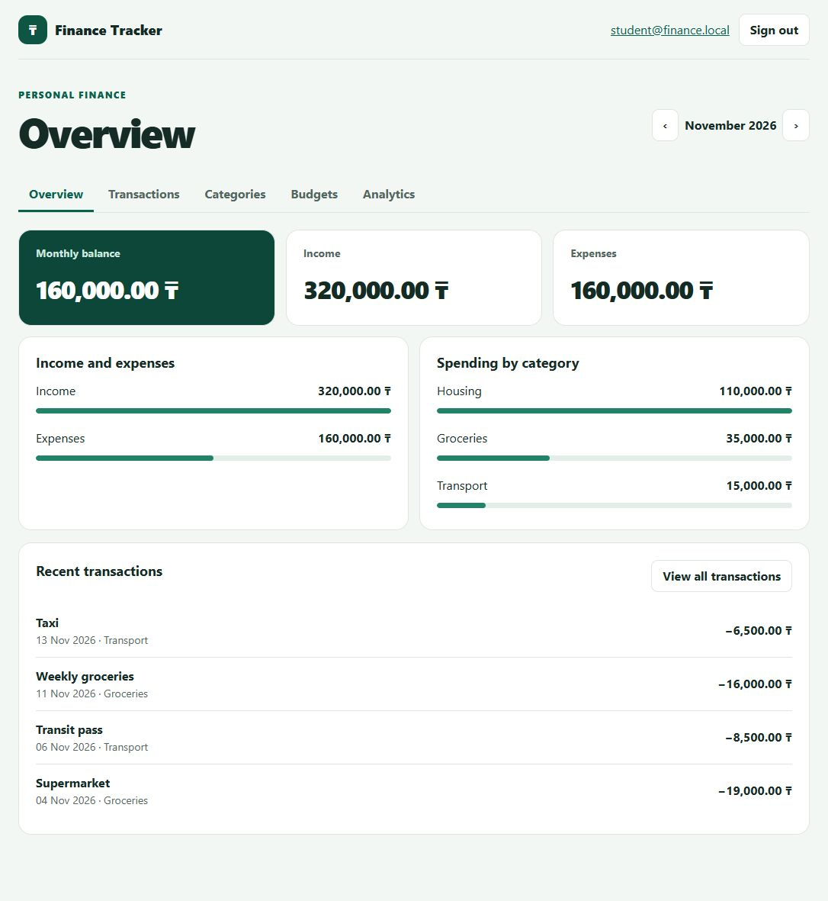

# FinanceTracker

**Final C# Project | Personal Finance Management Web Application**  
**Group:** IT-2508  
**Team (as listed in the submitted project documentation):** Rat Renat and Yerkebulan Alshynbekuly

FinanceTracker is an English-language **Blazor Interactive Server** web application for recording personal income and expenses, setting monthly budgets, and reviewing spending patterns. All displayed monetary values use **Kazakhstani tenge (KZT)**.

The project is designed for a **local academic demonstration**. Users enter their transactions manually; the application does not connect to bank accounts or transfer money.



## 1. Project Goal and Practical Value

People may spend money without keeping a clear record of where it goes. FinanceTracker brings transactions, categories, budgets, and basic analytics together in one interface. Its goal is to help users review their financial activity and make informed budgeting decisions.

## 2. Implemented Features

- **User accounts:** registration, login, logout, profile/password management, authenticator-based two-factor authentication (through ASP.NET Core Identity), and account deletion.
- **Monthly overview:** income, expenses, balance (`income - expenses`), category charts, and four most recent transactions.
- **Transactions:** create, view, edit, and delete income or expense records, with date, category, amount, and optional note. Search by note/category, filter by category, and paginate at **20 transactions per page**.
- **Categories:** create, rename, and delete income/expense categories. Duplicate names are restricted within the same user and flow type. A referenced category cannot be deleted until its related records are removed or reassigned.
- **Budgets:** set one spending limit per expense category per month; view spending progress, remaining allowance, or the amount over budget.
- **Analytics:** view spending by category and a **current-month** expense projection based on average daily spending. The projection is a simple calculation, not machine learning.
- **CSV export:** download all transactions for the selected month, regardless of the currently applied search filter.
- **Sample data:** load four categories, six transactions, and three budgets into an account with no categories.

## 3. Technology Stack

| Technology | Use in FinanceTracker |
| --- | --- |
| C# and .NET 10 | Application logic and runtime |
| ASP.NET Core Blazor Interactive Server / Razor | Interactive web pages and components |
| HTML, CSS, Bootstrap assets | Interface structure and styling |
| Entity Framework Core with SQLite | Relational data access and persistence |
| ASP.NET Core Identity | Accounts, authentication, and security features |
| LINQ and C# records | Filtering, grouping, aggregation, and value-oriented calculations |
| xUnit, bUnit, ASP.NET Core integration testing | Automated unit, component, and integration tests |
| Playwright | Browser-based user-flow checks |

The charts use the project's own Blazor components (such as `BarChart.razor`), **not Chart.js**.

## 4. Architecture and Design

FinanceTracker separates presentation, data access, and financial calculations:

```text
User / Browser
     |
Blazor UI (FinanceWorkspace.razor and reusable components)
     |
Ledger service (ownership checks, validation, CRUD)
     |
Entity Framework Core (FinanceDb)
     |
SQLite financial database
```

The UI also calls calculation functions in `Domain/Finance.cs` for monthly totals, grouped spending, formatting, and forecasting. ASP.NET Core Identity uses a separate database context for accounts.

### Important source files

| File | Responsibility |
| --- | --- |
| `FinanceTracker/Program.cs` | Registers Blazor, Identity, databases, services, and endpoints; starts the application |
| `FinanceTracker/Components/Pages/FinanceWorkspace.razor` | Main tabs, forms, dashboard, and UI event handlers |
| `FinanceTracker/Components/Pages/Metric.razor` | Reusable financial metric card |
| `FinanceTracker/Components/Pages/BarChart.razor` | Reusable bar chart |
| `FinanceTracker/Components/Pages/MonthPicker.razor` | Selected-month navigation |
| `FinanceTracker/Data/Ledger.cs` | Asynchronous CRUD, validation, and account ownership checks |
| `FinanceTracker/Data/FinanceDb.cs` | Category, Transaction, and Budget entities, keys, and indexes |
| `FinanceTracker/Data/ExportEndpoint.cs` | Authorized monthly CSV download |
| `FinanceTracker/Data/AccountDeletion.cs` | Coordinated account and finance-record deletion |
| `FinanceTracker/Domain/Finance.cs` | Pure calculations, immutable `Entry`/`Totals` records, and input models |
| `FinanceTracker/Domain/MonthState.cs` | Selected month state |
| `FinanceTracker/Domain/CsvExport.cs` | CSV formatting and spreadsheet-formula protection |
| `FinanceTracker/Domain/Demo.cs` | Demo data generation |

### Functional programming techniques

- `Finance.Summarize()` uses LINQ `Aggregate()` and `with` expressions to calculate income and expenses with new `Totals` values.
- `Finance.Spending()` composes `Where()`, `GroupBy()`, and `Sum()` for category totals.
- `Finance.Forecast()` receives its inputs explicitly and does not query a database or the system clock.
- Side effects (database writes, account changes) remain in services rather than the calculation functions.

The overall application is **not purely functional**: forms and persistence services necessarily use mutable state and side effects.

## 5. Database and Data Integrity

Two SQLite files are created on first launch:

- `FinanceTracker/Data/app.db` — ASP.NET Core Identity account data.
- `FinanceTracker/finance.db` — financial categories, transactions, and budgets.

The financial data model consists of `Category`, `Transaction`, and `Budget`. A transaction or budget belongs to one category. The model includes owner-aware foreign keys, indexes, and restrictions that prevent accidental deletion of referenced categories. Budgets are unique for an owner, month, and category.

Amounts are entered using `decimal` and stored as `long` integers representing **hundredths of one tenge**. Form validation checks positive amounts and other field constraints. Dates for financial operations are restricted by the application rules.

Account deletion uses a coordinated SQLite transaction across the two database files. A failed deletion rolls back the database changes; successfully deleted accounts cannot continue using stale sessions to create records.

## 6. Installation and Local Run

**Requirements:** .NET 10 SDK, Visual Studio Code or Visual Studio, and a browser. Internet access may be needed during the first NuGet package restore.

Open a terminal in the directory containing `FinanceTracker.sln` and run:

```powershell
dotnet restore FinanceTracker.sln
dotnet run --project FinanceTracker --launch-profile http
```

Open **http://localhost:5142**, create an account, and optionally click **Load sample data**. Keep the terminal running while using the app; press **Ctrl+C** to stop it.

In VS Code on Windows, you can also select **Terminal → Run Task → Run Finance Tracker**. The repository includes `Start-FinanceTracker.ps1` for repeated local launching.

### User workflow

1. Register and sign in.
2. Create categories or load sample data.
3. Add income and expense transactions.
4. Review monthly totals and category charts in **Overview**.
5. Create or edit spending limits in **Budgets**.
6. Use **Analytics**, month navigation, search, and CSV export as needed.

## 7. Testing and Verification

Run the .NET test suite from the solution directory:

```powershell
dotnet test FinanceTracker.sln
```

To collect coverage:

```powershell
dotnet test FinanceTracker.sln --collect:"XPlat Code Coverage"
```

**Recorded verification from 14 November 2026** (`QA.md` and `verification/`):

| Metric | Recorded result |
| --- | --- |
| .NET tests | **67 passed**, 0 failed, 0 skipped |
| Line coverage | **70.32%** (1,844 / 2,622 lines) |
| Branch coverage | **56.39%** |
| Browser verification | Edge, Chrome, Firefox, and Playwright WebKit on Windows |
| Responsive checks | Widths of 375, 768, and 1280 pixels |

The tests cover calculations, validation, real SQLite CRUD, owner isolation, authentication, component interactions, CSV export, and account deletion. Browser replay tests are stored in `tests/e2e.cjs`; setup instructions are in [`tests/README.md`](tests/README.md).

These are **saved test results**, not a claim that the tests have been rerun on every computer. Coverage measures executed code and does not guarantee that all bugs are absent.

## 8. Security and Error Handling

- ASP.NET Core Identity manages accounts and password hashing.
- Authentication and owner filtering restrict access to financial records.
- After five failed password attempts, sign-in is temporarily locked for five minutes.
- Financial inputs are validated in both the UI and service logic.
- Database transactions and relational constraints help protect data integrity.
- The CSV exporter escapes text and protects against spreadsheet formula injection.
- Failed operations produce user-facing error messages, while unexpected exceptions are logged.

**Important:** the repository uses `IdentityNoOpEmailSender`; real email delivery and email-based password recovery are **not configured**.

## 9. Quality, Constraints, and Future Work

The interface uses reusable Blazor components, scoped state for month selection, responsive CSS, and asynchronous database operations. Read-only queries use `AsNoTracking()`; database indexes support common owner/month lookups.

This project is intended for a **local final-project demonstration**, not a production financial service. Its current limitations include:

- No direct bank integration or automated import from bank accounts.
- No implemented savings-goal tracker or separate 80%-of-budget notification feature.
- Forecasting is a simple average-based projection, available for the current month.
- SQLite's concurrent-write limitations and last-write-wins edits; large-scale hosting was not demonstrated.
- Native macOS/Linux runs, real Safari on macOS, physical mobile devices, accessibility audits, and detailed CPU/network profiling were not verified.
- Public deployment still needs HTTPS configuration, persistent protected keys, a real email sender, backups, and monitoring.

Possible future work includes production deployment configuration, more advanced reporting and forecasting, and a server database such as PostgreSQL if concurrency requirements grow. **These are planned improvements, not implemented features.**

## 10. Evaluation Criteria: Evidence in the Repository

The final-project rubric contains **20 criteria (5% each)**. The references below describe available evidence; they do not claim a particular grade.

| Criterion | Evidence / current boundary |
| --- | --- |
| 1. Code Structure and Design | Separate `Components`, `Data`, and `Domain` areas |
| 2. Component Reusability | `Metric`, `BarChart`, `MonthPicker`, `RowActions`, `FormActions` |
| 3. Cross-Platform Compatibility | Web-based design; native macOS/Linux unverified |
| 4. State Management | `MonthState`, component state, Blazor cascading values |
| 5. UI Design | Shared styles and dashboard components in `wwwroot/` and `Components/` |
| 6. User Experience | Navigation, forms, filters, pagination, feedback messages |
| 7. Responsiveness | CSS and recorded 375/768/1280-pixel browser checks |
| 8. Core Functionality | Transaction/category/budget CRUD, dashboard, analytics, export |
| 9. Advanced Features | Identity, authenticator 2FA, protected CSV export, account deletion |
| 10. Error Handling and Resilience | Data annotations, `LedgerRuleException`, UI handling, database transactions |
| 11. Efficiency | `AsNoTracking()`, indexes, bounded transaction-list pagination |
| 12. Scalability | Separated layers; SQLite/multi-server limitations acknowledged |
| 13. Resource Utilization | Asynchronous EF Core calls and disposed database contexts; profiling pending |
| 14. Testing Coverage | xUnit, bUnit, integration tests, saved coverage reports |
| 15. Quality Assurance | `QA.md`, saved browser runs/screenshots, regression checks |
| 16. Documentation | `README.md`, `ARCHITECTURE.md`, `QA.md`, `tests/README.md` |
| 17. Innovation | Combined budget monitoring, financial overview, and simple month-end forecast; no claim of industry novelty |
| 18. Creative Use of C#/.NET/Blazor | LINQ, immutable records, event callbacks, DI, reusable components |
| 19. Professionalism | Documented setup, tests, limitations, and verification artifacts |
| 20. Presentation | A slide deck is supplied with the submission; the oral defense is mandatory |

## 11. Repository Documentation

- [`ARCHITECTURE.md`](ARCHITECTURE.md) — class/sequence diagrams, design decisions, and functional-programming concepts.
- [`QA.md`](QA.md) — executed tests, verification results, and unresolved checks.
- [`tests/README.md`](tests/README.md) — browser-test instructions.
- [`verification/`](verification/) — recorded test results, coverage, JSON browser results, and screenshots.
- `FinanceTracker.Presentation (2).pptx` — presentation file supplied alongside the project folder in the final ZIP.

## 12. Team Contributions

According to the project's existing submission documentation:

- **Rat Renat:** SQLite data model, transaction/category CRUD, account deletion, and presentation.
- **Yerkebulan Alshynbekuly:** Blazor UI, budgets, analytics, CSV export, and automated tests.

Both team members are expected to understand and defend the complete project.
